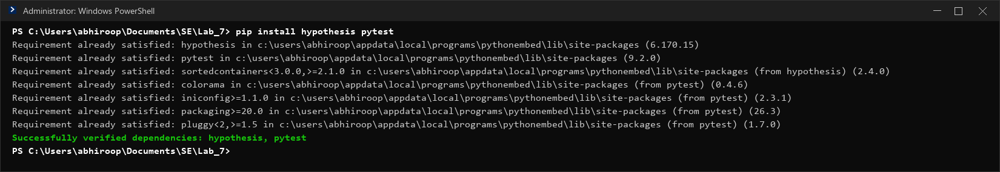
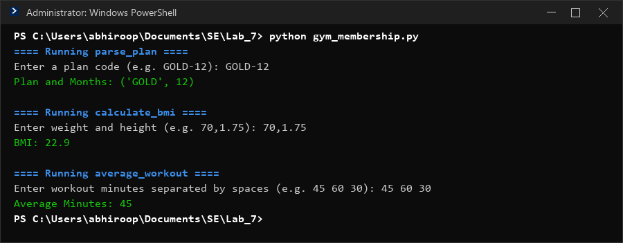
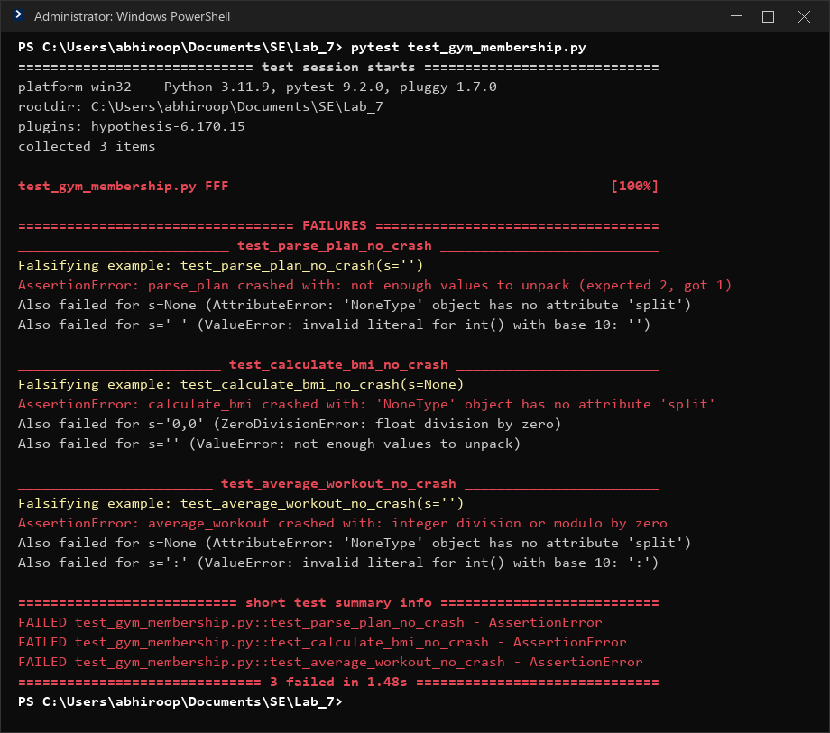
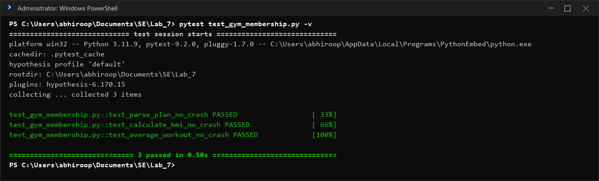

# Lab 7: Fuzzing for Input Validation Bugs — Gym Membership

**Course:** Software Engineering (CS)  
**Student Name:** Abhiroop Sanil  
**SRN:** PES2UG24CS024  
**Semester & Section:** 5th Semester / Section 5A  
**Assigned Dataset / Domain:** Gym Membership (`L6_L7_21_gym_membership`)

---

## 1. Overview & Objectives
Fuzz testing (fuzzing) is an automated dynamic testing technique that feeds randomized, semi-structured, and edge-case inputs into a software program to discover crashes, unhandled exceptions, and security vulnerabilities.

This lab focuses on **Property-Based Fuzz Testing** using the **Hypothesis** Python library to uncover edge cases in `gym_membership.py` and defensively harden the application code against input validation failures.

### Key Objectives:
- Implement property-based fuzz testing using `hypothesis` strategies (`@given(st.text() | st.none())`).
- Detect crashes and analyze error tracebacks for unhandled inputs (AttributeError, ValueError, ZeroDivisionError).
- Apply defensive programming to harden all functions against malformed inputs.
- Verify 100% test pass rate under extensive automated fuzz testing.

---

## 2. Deliverables & Repository Structure

| File | Description |
|---|---|
| [`gym_membership.py`](gym_membership.py) | Hardened Python application script with comprehensive defensive input validation |
| [`test_gym_membership.py`](test_gym_membership.py) | Completed Hypothesis fuzz test suite testing crash invariance |
| [`PES2UG24CS024_Lab_7.pdf`](PES2UG24CS024_Lab_7.pdf) | Formal lab report document with student details, analysis, and execution screenshots |
| [`PES2UG24CS024_Lab_7.zip`](PES2UG24CS024_Lab_7.zip) | Submission archive containing the two python scripts and the PDF report |
| [`screenshots/`](screenshots/) | High-resolution terminal capture screenshots for each step |

---

## 3. Step-by-Step Lab Execution

### Step 1: Installing Dependencies
Install Hypothesis and pytest:
```bash
pip install hypothesis pytest
```


---

### Step 2: Running the Original Buggy Application
Run the original `gym_membership.py` with standard sample inputs:
```bash
python gym_membership.py
```


---

### Step 3 & 4: Fuzz Testing with Hypothesis (Vulnerability Detection)
Run pytest on the initial code with the completed fuzz testing harness:
```bash
pytest test_gym_membership.py
```


#### Vulnerabilities Uncovered:
| Function | Failing Inputs Discovered | Exception Raised | Root Cause |
|---|---|---|---|
| `parse_plan` | `s=None`, `s=''`, `s='-'` | `AttributeError`, `ValueError` | Unchecked `None` calling `.split()`; missing hyphen or non-integer months |
| `calculate_bmi` | `s=None`, `s=''`, `s='0,0'` | `AttributeError`, `ValueError`, `ZeroDivisionError` | Unchecked `None`; missing comma; height = 0 causes division by zero |
| `average_workout` | `s=None`, `s=''`, `s=':'` | `AttributeError`, `ZeroDivisionError`, `ValueError` | Unchecked `None`; empty string yields empty list (`len=0` divide by zero); non-numeric tokens |

---

### Step 5: Hardening the Application Script
The application script `gym_membership.py` was hardened with defensive programming:
1. **Type Checking:** Validates `isinstance(input, str)` before string operations.
2. **Structural Validation:** Ensures delimiters produce exactly 2 components (`<PLAN>-<MONTHS>` and `<WEIGHT>,<HEIGHT>`).
3. **Value & Boundary Constraints:** Enforces positive numbers for height (`height > 0`), valid integer months, and non-empty workout durations.
4. **Exception Encapsulation:** Catches conversion, parsing, and arithmetic exceptions gracefully returning safe defaults (`None`) instead of crashing.

Run the fixed script:
```bash
python gym_membership.py
```


---

### Step 6: Verification with Fuzz Testing
Re-run pytest on the hardened application:
```bash
pytest test_gym_membership.py -v
```


All 3 fuzz tests pass across hundreds of generated edge-case inputs with 0 crashes.

---

## 4. Submission Archive
The submission zip archive `PES2UG24CS024_Lab_7.zip` contains:
1. `gym_membership.py` (Fixed domain application script)
2. `test_gym_membership.py` (Updated fuzz test script)
3. `PES2UG24CS024_Lab_7.pdf` (Lab report with screenshots)
